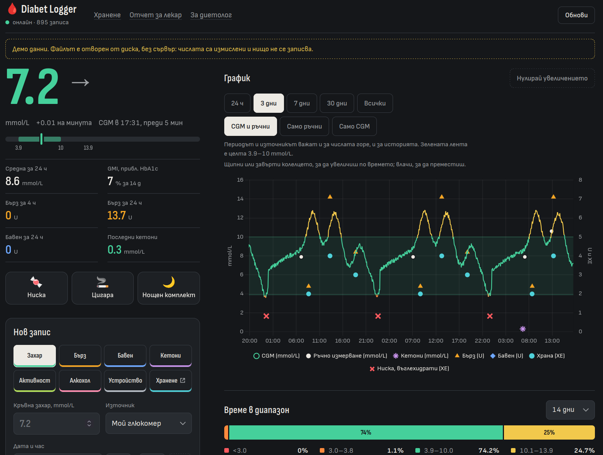

# Diabet Logger

Self-hosted тракер за захар, инсулин, хранене и CGM, с калкулатор на дозите и отчети за лекар и диетолог.
FastAPI + SQLite + Chart.js, един контейнер.



> **⚠️ Disclaimer:** This is a personal hobby project, NOT a certified medical device or clinical software. It is not intended to replace professional medical advice, diagnosis, or treatment. Dose calculations are suggestions only — always verify with your healthcare provider. Use entirely at your own risk.
>
> Калкулаторите дават **предложение**, не медицински съвет. Дозата винаги я потвърждава човекът, който инжектира.

## Какво може

- **Записи:** BG (mmol/L), бърз и бавен инсулин (U), кетони (mmol/L), хранене (XE), активност (мин), алкохол (ед.), смяна на устройство (ампула/сензор/пач помпа/основа помпа/смяна настройки)
- **Поддръжка на помпа (Medtrum Nano):** при бърз инсулин — доставка (помпа/писалка/венозно), вид инсулин (Fiasp/NovoRapid/друг), вид болус (нормален/удължен/комбо с продължителност). При бавен — доставка и вид инсулин. В историята записите показват иконки за доставката и вида болус
- **Източник на BG:** при ръчно измерване — свой глюкомер, болничен или CGM ръчно. Болничните измервания показват 🏥 в историята
- **Кетони:** приемат стойност 0 (за нулев резултат при тест)
- **CGM:** показанията от Juggluco се дърпат от телефона (`juggluco_pull.py`) и се записват като обикновени `bg` записи с бележка `[CGM]`. Ръчните измервания от BT глюкомер (напр. Contour Next One) се дърпат от Juggluco `/x/amounts` (TSV, етикет `Blood`, стойност в mmol/L) и се записват с бележка `[Глюкомер-BT]` и `meta.source: "own"`, с отделен watermark и дедупликация по време
- **Time-in-Range** (Battelino et al. 2019), **GMI** (Bergenstal 2018), средна BG, SD, CV%
- **График** със zoom и преместване по времето. CGM е тънка линия, ръчните измервания са точки. Филтри по период и по източник (BG + CGM / ръчни / само CGM). Маркери за храна (XE) и за лечение на ниска; бележката излиза при посочване
- **История** с редакция на бележките на място (стойността и часът не се променят, това е умишлено: audit trail)
- **Хранене (`/meal`):** калкулатор на доза по XE и текуща BG, вечерна доза, настройки на правилата
- **Бутон „Ниска":** под статистиката — бързи въглехидрати с едно докосване (грамове × брой), с избор на дата и час (по подразбиране сега). Записва се като `meal` с `carbs_g`, XE по настройката `xe_grams_carbs` и бележка `[ХИПО] 5×3g`
- **Бутон „Цигара":** брой (по подразбиране 1), бележка и час. Записва се като `activity` (5 мин, лека) с бележка `[ЦИГАРА] 2 бр.`, за проследяване на ефекта върху захарта
- **Бутон „Нощен комплект":** предефинирани бързи (10 g) и опционално бавни въглехидрати, с час. За лечение на нощна ниска с измерено количество. Записва се като `meal` с бележка `[ХИПО] Нощен: 10g бързи + 8g бавни`
- **Помпа панел:** четири бутона за бързи записи — ⚡ Темп базал (%, продължителност), 💉 Болус (единици, ръчен override), ⏸ Спиране (продължителност), 🔄 Възобновяване. Записват се като `device_change` с мета `temp_basal_pct`, `temp_basal_min` или `resume`
- **Пач информация:** при смяна на устройство тип „Пач помпа" — полета за напълнено (U), остатък (U) и място на тялото (корем, ръка, крак, гръб — ляво/дясно). Показва се в историята: „Пач · 150U, ост. 45U, ръка Д"
- **Етикети за периоди:** бутон 🏷️ Период за маркиране на времеви диапазони — 🏥 Болница, ✈️ Пътуване, 🤒 Болест, 😰 Стрес, 🏃 Активен ден, 📌 Друго. Всеки период има начална и крайна дата и бележка. Показва се като цветна лента на графиката и като запис в историята
- **Тренд и скорошен инсулин:** до „Последна BG" стрелка и скорост на CGM за последните ~15 мин (→ ↗ ↑ ⇈ / ↘ ↓ ⇊; червено при ≥0.11 mmol/L/мин). Карта „Бърз 4ч": сумата бърз инсулин за последните 4 ч и часът на последната доза. Само за справка, не влизат в калкулаторите
- **Дневен профил:** етикет за деня (Бърз / Нормален / Бавен) и бележка, само за справка
- **Отчети:** `/report` за лекар, `/print-review` за диетолог (A4 за печат)
- **Часова зона:** избира се от падащо меню в Настройки (виж "Часова зона")
- **Login** (потребител и парола, JWT 30 дни) и/или **API key**, и двете по желание
- **Автообновяване на 60 сек** (спира, докато редактираш бележка) и бутон „⟳ Обнови", който дърпа новите CGM показания
- **Стрийм панел** за OBS — `static/overlay.html` (виж „Стрийм панел")
- **Export / Import** JSON и CSV. CSV с избор на период (От / До, виж „Export CSV")

## Интерфейс

Главната страница е mobile-first, с тъмна тема и шрифт Sofia Sans (с кирилски форми на буквите; идва от Google Fonts, а трите реда в `<head>` се махат за офлайн работа — остава системният шрифт).

- **Последно показание** като едро число с цвят по зоната и скала отдолу, на която се виждат целевият диапазон 3.9–10 и къде попада стойността. Скалата е фиксирана 2–20 mmol/L, за да стои стабилна; над 20 маркерът опира в края.
- **Графиката** сама нагласява мащаба си по данните. Кривата сменя цвят по зоната (в норма, високо, ниско), а целевият диапазон 3.9–10 е лента зад нея. Временният базал се показва като цветна лента: оранжева за повишен (>100%), синя за намален (<100%), червена за спиране (0%), с етикет на процента горе. Етикетите за периоди (болница, пътуване и др.) се виждат като бледи цветни ивици с иконка долу.
- **Цветът означава данни:** рамката и бутоните са едноцветни, а цветно е само измереното и записаното. Табовете за нов запис носят цвета на типа, който записват.
- На телефон долна лента води до разделите (Сега, Запис, График, История, Още); на широк екран записването стои вляво, а прегледите вдясно.
- **Полетата за дата и час** следват часовника, докато не ги пипнеш; бутонът „Сега" ги връща. При запис непипнатото поле е текущият момент, не часът при отваряне на страницата.
- Отворена направо от диск (`file://`, без сървър), страницата влиза в **демо режим** с измислени данни и надпис отгоре — за разглеждане, без нищо да се записва. Заредена от сървъра, демото не се включва.

## Quick start

```bash
cd diabet-logger
docker compose up -d --build
```

Отвори `http://<server>:8765/`. Без auth по подразбиране (допустимо зад WireGuard / LAN).

**Важно при промени:** `static/` не е bind mount, а се пакетира в образа. След промяна на `.html` или `.py` трябва `docker compose up -d --build`. Базата (`data/`) е bind mount и се запазва.

## Конфигурация (`.env`)

| Променлива | По подразбиране | За какво |
|---|---|---|
| `DIABET_USERNAME`, `DIABET_PASSWORD` | – | Вход от браузър (JWT) |
| `DIABET_API_KEY` | – | `X-API-Key` за скриптове |
| `DIABET_JWT_SECRET` | авто в `data/.jwt_secret` | Ключ за JWT; рестартът не обезсилва токените, ако `data/` се пази |
| `DIABET_TOKEN_TTL_DAYS` | `30` | Валидност на токена |
| `DIABET_TZ` | `Europe/Sofia` | Зона по подразбиране за дневните статистики и отчети. Може да се смени от Настройки (виж "Часова зона"); времената се пазят в UTC |
| `JUGGLUCO_HOST` | – | Адрес на телефона с Juggluco (достъпен през WireGuard). Нужен за CGM синхронизацията |
| `JUGGLUCO_PORT` | `17580` | Порт на webserver-а на Juggluco |
| `JUGGLUCO_API_SECRET` | – | `api_secret` на Juggluco (auth в пътя на URL-а) |
| `DIABET_LOGGER_API_KEY` | = `DIABET_API_KEY` | По желание: друг ключ само за `juggluco_pull.py`. По подразбиране скриптът ползва `DIABET_API_KEY` |
| `DIABET_DB`, `DIABET_SECRET_FILE` | `/data/...` | Пътища вътре в контейнера |

`.env` е с права `600` и никога не влиза в git. Без нито една auth променлива приложението е отворено.

## Файлове

```
app.py                 FastAPI backend
juggluco_pull.py       дърпа CGM от Juggluco на телефона (през WireGuard)
juggluco_watermark.json докъде е стигнал последният pull
dedupe.py              намира и чисти дублирани записи, по подразбиране само отчет (виж "Дубликати")
logger2diabetesm.py    конвертор от Logger CSV към Diabetes:M ENTRIES формат за импорт
static/profiles.html   профили на помпата: базал, ISF, CR — история на настройките със сравнение
qa.py                  QA тестове: python3 qa.py
static/                index.html, meal.html, report.html, print-review.html, cgm_view.html
data/diabet.db         SQLite (bind mount)
```

## Модел на данните

Една таблица `entries` плюс помощни таблици.

| Колона | |
|---|---|
| `type` | `bg`, `fast`, `slow`, `ketones`, `meal`, `activity`, `alcohol`, `device_change` |
| `value` | BG/кетони mmol/L, инсулин U, хранене XE, активност мин, алкохол ед. (`device_change` = 0; видове: `ampule`, `sensor`, `patch`, `pump_base`, `settings_change`) |
| `time` | ISO 8601, в UTC |
| `notes` | свободен текст (единственото, което се редактира) |
| `meal_time`, `carbs_g`, `meta` | по желание: начало на храненето, грамове въглехидрати, JSON с допълнения (напр. `{"intensity":"moderate"}` за активност, `{"device_type":"patch"}` за смяна устройство, `{"delivery":"pump","insulin_type":"fiasp","bolus_kind":"extended","bolus_duration_min":60}` за бърз инсулин, `{"source":"hospital"}` за BG, `{"device_type":"settings_change","temp_basal_pct":150,"temp_basal_min":60}` за темп базал, `{"device_type":"patch","patch_filled_u":200,"patch_remaining_u":45,"patch_site":"abdomen-R"}` за пач, `{"device_type":"period","period_type":"hospital","period_start":"2026-11-09","period_end":"2026-11-13"}` за период) |

- **`UNIQUE(type, time)`:** два записа от един тип със същото време не могат да съществуват. Повторен POST връща съществуващия запис с `"duplicate": true`, а importът пропуска дублираните. Следствие: два ръчни BG в една и съща минута се слепват в един.
- **`settings`:** key-value. Ред `rules` са правилата на калкулатора (JSON), ред `timezone` е избраната часова зона.
- **`day_profiles`:** `date` (локален ден), `profile` (`fast`/`normal`/`slow`), `notes`. Не влиза в `/api/export`.
- **`basal_profiles`:** `id`, `name`, `active_from` (YYYY-MM-DD), `basal` (JSON, 24 стойности U/h), `isf` (JSON, сегменти `[{from, value}]`), `cr` (JSON, сегменти `[{from, value}]`), `notes`. История на настройките на помпата — кой профил кога е бил активен.

## API

Всичко е под `/api`. Auth (ако е конфигуриран): `X-API-Key: ...` или `Authorization: Bearer <jwt>`. Swagger: `http://<server>:8765/docs`.

| Method | Path | Описание |
|---|---|---|
| GET | `/api/health` | здраве, кои auth методи са включени, часова зона |
| POST | `/api/login` | `{username,password}` → `{token,expires_at}` |
| GET | `/api/entries` | `?type=&from=&to=&limit=` (по подразбиране limit 20000) |
| POST | `/api/entries` | `{type,value,time,notes,meal_time?,carbs_g?,meta?}` |
| PATCH | `/api/entries/{id}` | `{notes}`, само бележките |
| DELETE | `/api/entries/{id}` | изтрива един запис |
| DELETE | `/api/entries` | изтрива ВСИЧКИ |
| POST | `/api/cgm-sync` | пуска `juggluco_pull.py`; връща последния ред от изхода. Таймаут 120 сек (504 ако телефонът е недостъпен) |
| GET | `/api/stats?days=14` | TIR, GMI, средна, SD, CV, инсулин на ден |
| GET | `/api/report?from=&to=` | пълен отчет за лекар |
| GET | `/api/export` | JSON, групиран по тип. `bg`, `ketones`, `meal` носят стойността в `value`, всички останали в `units` |
| POST | `/api/import` | `{bg:[],fast:[],...,replace:bool}`, сливане с пропускане на дубликати |
| GET / PUT | `/api/settings` | правилата на калкулатора (PUT е частичен) |
| POST | `/api/settings/reset` | връща правилата по подразбиране |
| POST | `/api/calc-dose` | `{bg,xe}` → препоръчана доза, разбивка, предупреждения |
| POST | `/api/calc-evening?bg=` | вечерна бавна доза и препоръка за закуска |
| GET / PUT / DELETE | `/api/timezone` | четене / избор `{timezone}` (IANA име, напр. `Europe/Sofia`) / връщане към `DIABET_TZ` |
| GET | `/api/day-profiles` | `?from=&to=` (дати `YYYY-MM-DD`) |
| PUT / DELETE | `/api/day-profiles/{date}` | `{profile,notes}` / изтриване |
| GET | `/api/day-response?date=` | числа за първата бърза доза за деня: BG при дозата и след 2 и 3 ч |
| GET | `/api/profiles` | всички базални профили, по `active_from` desc |
| POST | `/api/profiles` | нов профил `{name, active_from, basal, isf, cr, notes}` |
| PUT | `/api/profiles/{id}` | редакция на профил |
| DELETE | `/api/profiles/{id}` | изтриване |
| GET | `/api/profiles/active` | профилът с най-нов `active_from` ≤ днес |

Страници: `/` (главна), `/meal`, `/report`, `/print-review`, `/static/profiles.html` (профили на помпата).

## Калкулатор на дозите

Правилата живеят в таблицата `settings` и се редактират от `/meal` → Настройки (грамовете въглехидрати на 1 XE и от главната страница). **Стойностите по-долу са defaults в кода. Живите може да са различни, провери в Настройки.**

```
доза = XE × I:C + корекция
```

| Правило | Default |
|---|---|
| I:C при BG ≥ 5 / при BG < 5 | 3.0 / 2.0 U за 1 XE |
| Корекция при BG 10–13 / 13–16 / 16+ | +1 / +2 / +2 U |
| BG < 4 | блокира инсулина (хипо) |
| BG ≥ 15 | предупреждение: измери кетони |
| бърз инсулин преди < 2 ч | предупреждение за stacking |
| вечерен снак при BG ≤ | 6.0 (по подразбиране „до 200g кисело мляко") |
| вечерна бавна доза | 15 U (фиксирана) |
| 1 XE = | 12 g (в Настройки може да е друго, напр. 15 g) |

`/meal` записва храненето като 3 записа с един и същ час: BG, хранене и бърз инсулин.

## Дневен профил

Етикет за деня и бележка, видими в панела „Дневен профил" и като ред в „История". Панелът показва и числа за първата бърза доза за деня (BG при дозата, след ~2 ч и ~3 ч, промяната и промяната на единица; без храна в същото време това е чист корекционен ефект).

**Само за справка:** профилът не се чете от `calc-dose` и `calc-evening`, не променя дози и не влиза в export и отчети. Денят за `day-response` се смята по избраната часова зона.

## Часова зона

Всички времена се пазят в UTC. Часовата зона определя само **къде свършва денят** за дневните статистики, отчетите, броенето на активните дни и дневния профил. Избира се от падащото меню в Настройки, а ако нищо не е избрано, важи `DIABET_TZ` (по подразбиране `Europe/Sofia`). Смяната не пренаписва данни и важи веднага.

Часовете, които виждаш и въвеждаш в браузъра, следват часовата зона на самото устройство. Когато зоната на сървъра и на устройството са различни, под менюто има предупреждение: денят в отчетите и часовете на екрана може да не съвпадат.

## Референтни диапазони

**BG (mmol/L):** `<3.0` много ниска · `3.0–3.8` ниска · `3.9–10.0` в диапазон · `10.1–13.9` висока · `>13.9` много висока

**Кетони (кръвни, β-хидроксибутират, mmol/L):**
- `<0.6` нормални
- `0.6–1.5` повишени: проверка на BG, хидратация
- `1.5–3.0` риск от DKA: контакт с лекар
- `>3.0` спешно

**TIR цели (T1D):** в диапазон >70%, <3.0 mmol/L под 1%, обща хипо под 4%, CV <36%.

**GMI** е оценка по средната BG и не заменя лабораторно HbA1c. Валиден при 14+ дни редовни измервания. Със CGM всяко показание се брои като измерване, така че TIR и честотата на хипо вече са върху плътен поток от данни.

## CGM

- `POST /api/cgm-sync` (бутонът „⟳ Обнови") пуска `juggluco_pull.py`, който дърпа новите показания от телефона през WireGuard и ги записва с бележка `[CGM]`. Прогресът се пази в `juggluco_watermark.json`, така че всеки pull е инкрементален.
- **Конфигурация без тайни във файловете:** `JUGGLUCO_HOST`, `JUGGLUCO_PORT` и `JUGGLUCO_API_SECRET` са в `.env` и стигат до контейнера през `environment:` в `docker-compose.yml`. Скриптът ползва `DIABET_API_KEY` за достъп до приложението. Ако липсва променлива, излиза с код 2 и казва коя (без стойности). Върху хоста (ръчно или cron) скриптът чете и `.env` до себе си, а истинските променливи имат предимство.
- **Страницата `/static/cgm_view.html`** (CGM + ръчни измервания) няма ключ в кода. Пита за API ключ при първо отваряне и го пази само в `localStorage` на браузъра, под същите имена като останалите страници (`diabet_api_key`, `diabet_token`). Бутонът „API ключ" го сменя, а при отказан достъп автообновяването спира.
- Автообновяването на страницата само презарежда от базата. Ако искаш то да дърпа и от телефона, в `index.html` има константа `AUTO_SYNC_CGM` (по подразбиране `false`).
- Повторно изпратено показание не се дублира заради `UNIQUE(type, time)`.

## Export CSV

Бутонът „Export CSV" в Настройки тегли **целия** dataset от `/api/export` и го филтрира в браузъра.

- **Период:** полетата „От" и „До" до бутона. Празни = всичко. Датите са местни дни, включително (00:00 на „От" до 23:59 на „До"). Ако „От" е след „До", нищо не се тегли.
- **Име на файла:** `diabet-log-2026-10-24.csv`, а с период `diabet-log-2026-10-01_2026-10-24.csv`.
- **Типове:** всички — `BG, FAST, SLOW, KETONES, MEAL, ACTIVITY, ALCOHOL, DEVICE_CHANGE`.
- **Колони:** `type, time_utc, time_local, value, unit, notes, carbs_g, meal_time, meta`. `time_utc` е източникът на истината; `time_local` е за четене и следва часовата зона на устройството. `meta` е JSON (напр. `{"intensity":"moderate"}`).
- **Мерни единици:** BG и кетони mmol/L, храна XE, инсулин U, активност min, алкохол бр. Стойностите са под 100, освен активността — до 600 минути (до 25.10.2026 и тя беше ограничена до 99).
- **Бележки-маркери:** `[CGM]` за показания от сензора, `[ХИПО]` за лечение на ниска.

> До 24.10.2026 CSV-то пишеше `undefined` за инсулина, защото четеше `value` вместо `units`, и изпускаше активност, алкохол и смяна на устройство. JSON експортът винаги е бил пълен.

## Стрийм панел

`static/overlay.html` — един панел с текущата глюкоза за OBS (Browser Source), прозрачен фон, текст на английски.

- **Адрес:** `http://<сървър>:8765/static/overlay.html#key=<DIABET_API_KEY>` — частта след `#` не стига до сървъра и не остава в логовете му. Ключът се запомня в `localStorage`.
- **Размер:** 400×260; за по-голям и остър — `&scale=2` и 800×520.
- **Опции:** `sync=0` — не тегли от телефона, само чете базата; `every=60` — секунди между обновяванията (мин. 30).
- **Данни:** CGM за последните 3 ч. На всяко обновяване първо вика `/api/cgm-sync` (тегли от Juggluco), после `/api/entries`.
- **Състояния:** зелено — нормално; жълто — под 5 или спад ≥ 0.11 mmol/L/мин; червено „LOW · PAUSE" — под 4; сиво — данните са по-стари от 10 мин.
- Без инсулин и без ръчни измервания — показва само това, което е подходящо за публика.

## Дубликати

Дубликат = два или повече записа с еднакви `(type, time)`. Възниква при изгубен `juggluco_watermark.json` или при повторен `juggluco_pull.py --full` и тихо изкривява TIR, средната и GMI.

При старт приложението се опитва да създаде `UNIQUE(type, time)`. Ако в базата вече има дубликати, индексът не се създава и в логовете има `[warn] UNIQUE(type,time) index NOT created`. Тогава:

```bash
cp data/diabet.db data/diabet.db.bak                  # backup първо
DIABET_DB=data/diabet.db python3 dedupe.py            # само отчет, нищо не променя (dry run)
DIABET_DB=data/diabet.db python3 dedupe.py --apply    # изтрива, пази записа с най-малък id, после създава индекса
docker compose restart
```

`DIABET_DB` по подразбиране сочи `/data/diabet.db` (пътят вътре в контейнера), затова от хоста се задава явно. Скриптът показва групите, в които дублираните записи имат **различни стойности**: това не са CGM resend-и и трябва да се прегледат на ръка, преди `--apply`.

## Backup

```bash
# ръчно
cp data/diabet.db backup/diabet-$(date +%F).db

# cron 03:00 всеки ден
0 3 * * * cp /path/diabet-logger/data/diabet.db /backup/diabet-$(date +\%F).db
```

## nginx reverse proxy

```nginx
server {
    listen 443 ssl http2;
    server_name diabet.ferencak.net;
    ssl_certificate     /etc/letsencrypt/live/diabet.ferencak.net/fullchain.pem;
    ssl_certificate_key /etc/letsencrypt/live/diabet.ferencak.net/privkey.pem;

    client_max_body_size 10M;

    location / {
        proxy_pass http://127.0.0.1:8765;
        proxy_set_header Host $host;
        proxy_set_header X-Real-IP $remote_addr;
        proxy_set_header X-Forwarded-For $proxy_add_x_forwarded_for;
        proxy_set_header X-Forwarded-Proto $scheme;
    }
}
```

## Sync между устройства

Един URL, една база. Страницата се обновява на 60 сек. Login токенът важи 30 дни, per-device.

## Миграции

Автоматични при старт: премахване на стария `CHECK` (v2 → v3), добавяне на колоните `meal_time`, `carbs_g`, `meta`, таблиците `settings`, `day_profiles` и `basal_profiles`. Данните се запазват.
